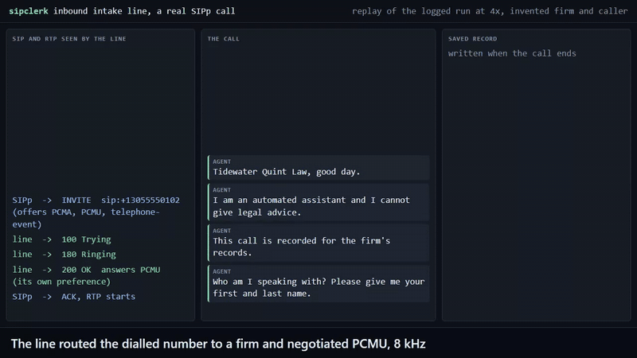
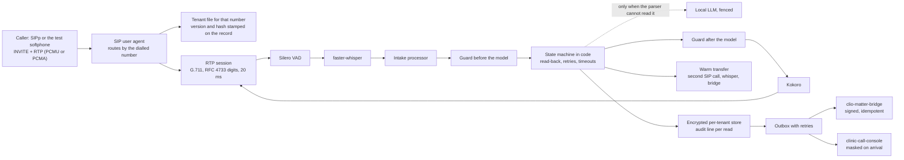

# sipclerk

[](https://github.com/Exalt24/sipclerk/actions/workflows/ci.yml)

A voice intake line for sample law firms: a real SIP call comes in, the dialled number picks the firm, and the intake rules run in code.



*A separate SIP client (SIPp, in Docker) places an INVITE with G.711 audio and keypad digits. This is the logged run replayed at 4x. Full quality: [`docs/demo.mp4`](docs/demo.mp4).*

**Proof, run here 2026-10-25 and 26:** 4,008 tests pass (4,005 and 3 skipped without the sibling bridge checkout) and 101 of 255 deliberate breaks rerun after the third review round (89 not saved), plus 26 rows after the last change, are all caught by a failing test. The 25 spoken tests over 20 scenarios (real SIP and RTP through Whisper, a local language model and Kokoro) passed 25 of 25 on the final code with the pinned versions (Pipecat 1.13.0), 24 min 40 s, saved in `docs/voice_suite_run_pins_2026-10-26.json`. The first audio of the answer arrived 619 ms (median) and 1611 ms (95th percentile) after the caller stopped talking, in the earlier run on a shared machine. Every figure and command is in [`docs/PROOF.md`](docs/PROOF.md).

> **Built and tested on a local stack.** Two sample firms, scripted callers with text-to-speech voices, with SIPp and the repo's own softphone as the SIP clients. The next step is a carrier phone number, because that is the part that costs money. [Limits](#limits) lists the scope.

## What it is

An agent that answers inbound calls for a law firm. Each call loads that firm's configuration by the number that was dialled, collects the details the firm needs and reads back the name and the number, applies the firm's rules without giving legal advice, and hands the caller to a person in office hours when a rule says so (otherwise a callback task). The record, transcript, summary and recording are stored per firm, encrypted (ids and times in clear), with roles and an audit line per read (no screen here reads them), and the finished intake goes to a case-management receiver and a call console.

It exists to show the three parts that are usually hand-waved: the telephony (a real INVITE, a negotiated codec, keypad digits, a transfer), the rules that must not depend on a prompt (a state machine and a guard in code, each broken on purpose to prove a test notices), and the tests that replay spoken calls and fail on a regression.

## How a call flows



The speech models run on this machine: Whisper `small.en` on the GPU, Kokoro on the CPU, and `qwen3.5:4b` through Ollama. No caller words go to a model service.

## What was measured

First audio after the caller stops talking, measured at the caller's side from the last RTP packet of its sentence to the first loud RTP frame of the agent's reply, over every turn of the 20 spoken scenarios:

| | Turns | Median | 95th percentile |
|---|---|---|---|
| All turns, as the caller hears them | 141 | 619 ms | 1611 ms |
| Agent side, from the detector's end of speech to the first audio, no model in the turn | 125 | 151 ms | 267 ms |
| Agent side, the language model in the turn (the closing acknowledgement) | 14 | 572 ms | 1019 ms |

Most of the median is the silence that ends a turn (0.5 s for a yes or a name, 1.0 s for a number, 1.2 s for a story), not compute: Whisper transcribes an utterance in about 155 ms, which is roughly all of the agent side's 151 ms median. Fixed prompts are rendered once and cached (370 sentences answered, 120 missed; two of the 141 turns have no agent-side figure); the 14 closing turns speak a sentence the model wrote, so their time includes rendering it, and a real caller's first read-back is rendered on the spot too, a time that was not kept. These figures were measured before the review round fixes; the replay after them did not save its numbers.

Per call, in the same earlier run, a completed intake took 80.4 s on the line (halved timeouts) and 1.08 model calls, without the staff summary call (nothing here is billed); the table is in [`docs/PROOF.md`](docs/PROOF.md).

The SIP leg, from [`docs/sipp_run.json`](docs/sipp_run.json): SIPp offered PCMA, PCMU and telephone-event, the line answered PCMU 8 kHz, 4,367 RTP packets arrived, eleven keypad events became the phone number, and the call ended with the agent's BYE. The audio path, with numbers, is in [`docs/codec_proof.txt`](docs/codec_proof.txt).

## What was hard

- **Speech after silence vanished.** Pipecat's streaming resampler swallowed speech that followed a long stretch of digital silence, so a caller who waited out the greeting went unheard. Found by replaying a clip after 12 seconds of zeros; fixed with a stateful upsampler that costs 2 ms (`test_stream_upsampler_*`).
- **A pause is not the end of a turn.** Callers pause between digit groups and inside a story, and a 0.5 s window cut them off. The window is now set per question (1.0 s for a number, 1.2 s for a story), and a phone number heard in pieces is kept and completed.
- **A failed write killed the hang-up.** A record with no qualification (a caller who went silent) crashed the delivery builder inside the hang-up path and left calls that never ended. A property test now delivers every record a random call can make, and a failing write is logged and the call still ends.
- **The model sits behind fences.** It reads an answer only when the plain parser could not (it also writes a closing acknowledgement when the call has a description, and a staff summary), its answers go through the same validators, its acknowledgement goes through the output guard, and with it down the call completes (`provider_llm_error`).
- **The guard fired on ordinary calls three times.** "I was hurt in a crash", then "I was taken to the emergency room", then "my back is hurt" and "an emergency hearing" each got the 911 line and a transfer. The rule now fires on a danger happening now, and tables pin each phrasing next to the same words said as a real alarm.
- **An offset typed into the file is not a clock.** The hours used a fixed UTC offset, so once the clocks went back the last open hour read as closed and the hour before opening as open. The firms now name a time zone, and a table checks both of them against it for two years, minute by minute around each clock change.
- **Features tested and never run.** A review that read the files found that `TenantStore.purge` had no caller, that the outbox held callers' names and stories in plaintext, and that six attempts over 31 seconds gave up on a receiver down for ten minutes. Retention now runs hourly, the outbox body is encrypted per firm, retries last about 23 hours, and `tests/test_wiring.py` fails when a public method of the store, the outbox or the server has no caller.
- **A transfer that outlived its call.** A caller who hung up while the desk phone rang left the INVITE uncancelled, so the receptionist answered a dead call. The desk leg is now its own task that the end of the call cancels at every stage (`tests/test_transfer_leg.py`).
- **A call that left no trace, and a task one receiver never got.** The line waited 5 s for the ACK while the stack resent its 200 OK for 32, so a late ACK left no session and a lost one no record: it now waits 64*T1, then hangs up and stores a callback task. A hang-up task reached only the console; one function now queues every finished call (`tests/test_ack_window.py`, `tests/test_outcome_receivers.py`).

## Run it

Needs Python 3.13, Docker Desktop for the SIPp caller (needs `host.docker.internal`, seen on Windows only), and [Ollama](https://ollama.com) with `qwen3.5:4b` (`ollama pull qwen3.5:4b`). Timings are on an RTX 5070 Ti, Whisper in float16; no GPU is required, it falls back to CPU int8 by itself (`SIPCLERK_DEVICE` forces one), and the timings here are from the GPU run.

```
pip install -r requirements-voice.txt
python scripts/fetch_models.py                      # downloads Kokoro (GitHub) and Whisper (Hugging Face) into ./models
python scripts/replay.py normal_intake              # one spoken call through the line, printed
python scripts/replay.py --list                     # 21: the suite's 20 and sipp_reference
```

The SIPp call (builds a container, plays the recorded caller as G.711 RTP and keypad events):

```
docker build -t sipclerk-sipp tools/sipp
python scripts/replay.py sipp_reference --json scratch/ref.json
python tools/sipp/make_scenario.py
python scripts/make_sipp_media.py scratch/ref.json tools/sipp/media/call.pcap
python scripts/sipp_demo.py --out scratch/sipp_run.json  # the committed record is docs/sipp_run.json
```

## Tests

| Layer | Command | What it covers | Count |
|---|---|---|---|
| Unit and property | `pip install -r requirements.txt`, then `python -m pytest` | tenant files, parsers, names in any language, the guard, the state machine (examples plus 160 seeded random calls), storage, retention and access, the outbox, the dialled number and the caller id, the ACK window, route sets, SIP, SDP, RTP, the language model fences, the office hours, and the third round's 59 corpus cases | 4,008 |
| The line with stand-in models | included in the above | real SIP and RTP over UDP, real voice activity detection and Pipecat, with Whisper and Kokoro replaced: routing, barge-in, silence, keypad, recording consent, transfer and bridge, an abandoned transfer, anonymous callers, a full intake | 18 |
| Spoken scenarios | `python -m pytest -m voice` | 25 tests over 20 scenarios replayed as WAV through real SIP, Whisper, the model and Kokoro (about 25 minutes; rewrites `docs/voice_suite_run.json`, copy it first) | 25 |
| Mutation check | `python scripts/mutation_check.py --layer all` | 255 deliberate breaks, one at a time (about 45 minutes), each must fail a named test | 255 distinct rows in three reports (the first holds two superseded ones); 12 of the 101 round 3 reruns and the 26 after the last change are saved, all killed; a round 3 sweep killed 276 of 281, not saved (PROOF section 9) |

Rows in `scripts/mutants_derived.py` take their edit from the syntax tree, not typed text. The check found seven test gaps (PROOF section 4); one mutant was dropped as equivalent.

## Limits

- **Carrier number next.** The SIP leg was proven with SIPp and the repo's own test softphone over UDP on one machine. A phone number from Twilio, Telnyx or a LiveKit SIP service is the next step, and it is where PSTN behaviour (jitter, loss, comfort noise, caller ID, carrier quirks) gets measured.
- **The SIP stack is small on purpose.** UDP only. No TLS, REGISTER, digest authentication, SRTP, forking, session timers or REFER; the transfer is a second call bridged by this process. A caller who hangs up before the ACK leaves no record. [`docs/DECISIONS.md`](docs/DECISIONS.md) says why it is not LiveKit, Asterisk or FreeSWITCH, and none of those was run.
- **Sample firms, scripted callers.** Two sample firms, scripted callers, text-to-speech voices on both ends of every call, white noise for the noisy line. English only, one speech model.
- **The guard is keyword rules.** It misses a rewording it was not written for and can fire on an innocent phrase. A caller who says only "my husband is hurt" is not sent to 911, and "someone is attacking me" is not a rule.
- **The plain readers take answers as heard.** A date answer is stored as heard (a read-back is the next step), a year alone is stored as 30 June, a keyword such as `trust` has an everyday meaning, `No problem` to the recording question turns recording off, and a caller who first denies being a client and then says they are one is not handed to a person. [`docs/DECISIONS.md`](docs/DECISIONS.md) and [`docs/LIMITS.md`](docs/LIMITS.md) list each known limit.
- **Retention and delivery have edges.** A call folder with no readable `meta.json` is skipped by retention, never deleted, because it cannot be told from a call still being saved. A delivery is dead about 23 hours after it was queued and waits for `scripts/requeue_dead.py`. A route given as a host name is not resolved.
- **Latency is this machine's.** A GPU shared with other work, one event loop for the line and the test caller, a model of 4 billion parameters, and spoken scenarios run with halved question timeouts. Hours are one window a day: no holidays, split or overnight shifts.
- **Case management is not Clio.** No Clio record is written: a Clio developer trial token answered 401 when tried (not recorded here; the trial ended in August 2026). The intake goes to the verification code of the sibling repo `Exalt24/clio-matter-bridge` as a Clio-shaped delivery and to a local `Exalt24/clinic-call-console` API (neither is needed for the tests; `docs/integration_run.txt` needs the console built locally), whose reasons are clinic ones, so every intake maps to `OTHER`.
- **No conflict check, no booking, no calendar.** A caller who says they are an existing client is handed to a person in office hours; nothing checks a conflict list.
- **Scripts and tests only.** No server command starts the line: it runs inside `replay.py`, `sipp_demo.py` and the tests. Three bridge tests skip without node and a `clio-matter-bridge` checkout beside this repo (or `CLIO_BRIDGE_DIR`): 4,005 passed and 3 skipped on a fresh clone.
- **No staff screen, two calls at once.** Nothing reads a stored record back (`TenantStore.read` has no caller, as `tests/test_wiring.py` says), and two simultaneous calls were run, not twenty.

## Layout

Folder by folder: [`docs/layout.md`](docs/layout.md).

## Stack

Python 3.13, Pipecat 1.13.0 pinned (the figures in this README were measured on 1.6.0), Silero VAD, faster-whisper, Kokoro (kokoro-onnx), Ollama with qwen3.5:4b, pydantic, cryptography, SIPp (GPL-2.0, in a container).

## License

MIT, see [`LICENSE`](LICENSE).
