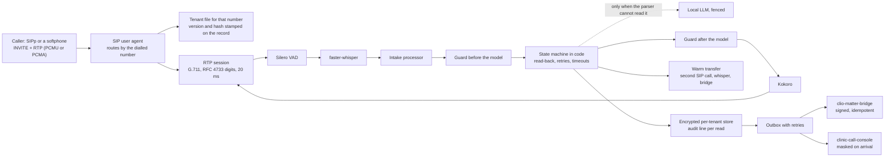

# sipclerk

[](https://github.com/Exalt24/sipclerk/actions/workflows/ci.yml)

A voice intake line for invented law firms: a real SIP call comes in, the dialled number picks the firm, and the intake rules run in code.


*A separate SIP client (SIPp, in Docker) places an INVITE with G.711 audio and keypad digits. This is the logged run replayed at 4x. Full quality: [`docs/demo.mp4`](docs/demo.mp4).*

**Proof, run on this machine on 2026-10-26:** 857 tests pass and 177 of 177 deliberate breaks are caught by a failing test. The 25 spoken tests over 20 scenarios (real SIP and RTP through Whisper, a local language model and Kokoro) last passed before the review round whose fixes are in [`docs/DECISIONS.md`](docs/DECISIONS.md) and have not been replayed since; the first audio of the agent's answer arrived 619 ms (median) and 1611 ms (95th percentile) after the caller stopped talking in that run. Every figure and command is in [`docs/PROOF.md`](docs/PROOF.md).

> **A lab, not a service.** Two invented firms, synthetic callers and voices, no real phone number, no production traffic and no customer. The one leg not tested is a real phone number from a carrier, because that is the only part that costs money. [Limits](#limits) lists the rest.

## What it is

An agent that answers inbound calls for a law firm. Each call loads that firm's configuration by the number that was dialled, collects and confirms the details the firm needs, applies the firm's rules without giving legal advice, and hands the caller to a person when a rule says so. The record, transcript, summary and recording are stored per firm, encrypted, with roles and an audit line per read (no screen in this lab reads them), and the finished intake is sent to a case-management receiver and a call console.

It exists to show the three parts that are usually hand-waved: the telephony (a real INVITE, a negotiated codec, keypad digits, a transfer), the rules that must not depend on a prompt (a state machine and a guard in code, each broken on purpose to prove a test notices), and the tests that replay spoken calls and fail on a regression.

## How a call flows



The speech models run on this machine: Whisper `small.en` on the GPU, Kokoro on the CPU, and `qwen3.5:4b` through Ollama. Nothing leaves it.

## What was measured

First audio after the caller stops talking, measured at the caller's side from the last RTP packet of its sentence to the first loud RTP frame of the agent's reply, over every turn of the 20 spoken scenarios:

| | Turns | Median | 95th percentile |
|---|---|---|---|
| All turns, as the caller hears them | 141 | 619 ms | 1611 ms |
| Agent side, from the detector's end of speech to the first audio, no model in the turn | 125 | 151 ms | 267 ms |
| Agent side, the language model in the turn (the closing acknowledgement) | 14 | 572 ms | 1019 ms |

Most of the median is the silence that ends a turn (0.5 s for a yes or a name, 1.0 s for a number, 1.2 s for a story), not compute: Whisper transcribes an utterance in about 155 ms, and the agent side adds about 151 ms. Fixed prompts are rendered once and cached. A read-back of a name or a number is rendered the first time and cached after that, so in this suite, where every caller repeats the same invented name and number, the speech cache answered 370 sentences and missed 120 in the suite, and no turn is measured on a sentence rendered on the spot. A real caller's read-back is rendered first and adds to that turn; its render time was not kept, so none is claimed.

Per completed intake call, from the call records (mean over 13 calls): 80.4 s on the line, 1.08 language model call using 82.62 prompt and 14.23 completion tokens in 0.28 s, 9.46 transcriptions, 45.54 s of synthesised speech. These are tokens and seconds, not a price: nothing here is billed, and a hosted provider would turn the same numbers into a different bill.

The SIP leg, from [`docs/sipp_run.json`](docs/sipp_run.json): SIPp offered PCMA, PCMU and telephone-event, the line answered PCMU 8 kHz, 4,367 RTP packets arrived, eleven keypad events became the phone number, and the call ended with the agent's BYE. The audio path, with numbers, is in [`docs/codec_proof.txt`](docs/codec_proof.txt).

## What was hard

- **Speech after silence vanished.** Pipecat's streaming resampler, used for 8 kHz to 16 kHz, swallowed speech that followed a long stretch of digital silence, so a caller who waited out the greeting was never heard. Found by replaying a clip after 12 seconds of zeros; fixed with a small stateful upsampler that costs 2 ms (`test_stream_upsampler_*`).
- **A pause is not the end of a turn.** Callers pause between digit groups and inside a story, and a 0.5 s window cut them off. The state machine now sets the window per question (1.0 s for a number, 1.2 s for a story, per firm if the file says so), and a phone number heard in pieces is kept and completed ("I have four one five so far, please say the rest").
- **A failed write killed the hang-up.** The first full voice run left calls that never ended: a record with no qualification (a caller who went silent) crashed the delivery builder inside the hang-up path. The property test `test_every_record_a_random_call_can_produce_can_be_delivered` now covers every record a random call can make, and a failing write or a raising transfer is logged and the call still ends.
- **The model sits behind fences.** It is asked only when the plain parser could not read an answer, its answer goes through the same validators, its acknowledgement goes through the output guard, and with it down the call completes (`provider_llm_error`).
- **A guard rule fired on ordinary calls.** The first emergency rule matched "I was hurt in a crash", which is most personal injury calls. A test that mixes an in-scope word with a charge found it.
- **Features tested and never run.** A review that read the files found that `TenantStore.purge` had no caller (every call kept for ever), that the outbox held callers' names, numbers and stories in plaintext, and that six retries over 31 seconds gave up on a receiver down for ten minutes. Retention now runs hourly, the outbox body is encrypted per firm and dropped once delivered, retries last about 23 hours with a `requeue`, and `tests/test_wiring.py` fails when a public method of the store, outbox or server has no caller.
- **A transfer that outlived its call.** A caller who hung up while the desk phone rang left the INVITE uncancelled: the receptionist answered a dead call and heard the whisper while RTP kept flowing to her phone. The desk leg is now its own task that the end of the call cancels at every stage (`tests/test_transfer_leg.py`).
- **The guard fired on the past tense again.** "I was taken to the emergency room" got the 911 line and a transfer. The rule now fires on a danger happening now, with 30 narrative and 19 live phrasings pinned.
- **A test helper lied twice.** The transfer check used a desk-phone call from an earlier scenario, and a quiet gap before the whisper counted as the whisper being over. Both were found because a bridge test failed on a call that worked, and fixed in the harness, not the agent.

## Run it

Needs Python 3.13, Docker Desktop for the SIPp caller (seen on Windows only), and [Ollama](https://ollama.com) with `qwen3.5:4b` (`ollama pull qwen3.5:4b`). Timings are on an RTX 5070 Ti, Whisper in float16; the int8 CPU fallback was not run.

```
pip install -r requirements-voice.txt
python scripts/fetch_models.py                      # Kokoro and Whisper into ./models
python scripts/replay.py normal_intake              # one spoken call through the line, printed
python scripts/replay.py --list                     # 21: the suite's 20 and sipp_reference
```

The SIPp call (builds a container, plays the recorded caller as G.711 RTP and keypad events):

```
docker build -t sipclerk-sipp tools/sipp
python scripts/replay.py sipp_reference --json scratch/ref.json
python tools/sipp/make_scenario.py
python scripts/make_sipp_media.py scratch/ref.json tools/sipp/media/call.pcap
python scripts/sipp_demo.py --out docs/sipp_run.json
```

## Tests

| Layer | Command | What it covers | Count |
|---|---|---|---|
| Unit and property | `python -m pytest` | tenant files, parsers, names in any language, the guard (one test per rule, emergency phrasings in the past and the present), the state machine (examples plus 160 seeded random calls), storage, retention and access, the outbox at rest and over a day of retries, the dialled number in every written form, route sets, SIP, SDP, RTP, the language model fences | 857 |
| The line with stand-in models | included in the above | real SIP and RTP over UDP, real voice activity detection and Pipecat, with Whisper and Kokoro replaced: routing, barge-in, silence, keypad, recording consent, transfer and bridge, an abandoned transfer, anonymous callers, a full intake | 18 |
| Spoken scenarios | `python -m pytest -m voice` | 25 tests over 20 scenarios replayed as WAV through real SIP, Whisper, the model and Kokoro (about 25 minutes, each call in real time) | 25 |
| Mutation check | `python scripts/mutation_check.py --layer all` | 177 deliberate breaks, one at a time, run in a copy of the repository, each must fail a named test | 177 killed |

The scenarios: a normal intake, the second firm, barge-in, a long silence, endless silence, a noisy line (white noise at 15 dB), a caller correction, invalid answers, an unsupported practice area, a request for legal advice (once, then repeated), an existing client, a busy desk phone, a desk phone that rings out, keypad digits, zero for a person, speech to text timing out, the language model down, the webhook receiver failing three times, and an after-hours call.

Rows in `scripts/mutants_derived.py` take their edit from the syntax tree (a function, a kind of change, a snippet of code), not from typed text, so rewording a line cannot break them. The mutation check found seven test gaps while it was being built, listed in [`docs/PROOF.md`](docs/PROOF.md); one mutant was dropped as equivalent and the file says why.

## Limits

- **No carrier, no real number.** The SIP leg was proven with SIPp and a softphone over UDP on one machine. A phone number from Twilio, Telnyx or a LiveKit SIP service was not bought or tried, so PSTN behaviour (jitter, loss, comfort noise, caller ID, carrier quirks) is untested.
- **The SIP stack is small on purpose.** UDP only. No TLS, REGISTER, digest authentication, SRTP, forking, session timers or REFER; the transfer is a second call bridged by this process. [`docs/DECISIONS.md`](docs/DECISIONS.md) says why it is not LiveKit, Asterisk or FreeSWITCH, and none of those was run.
- **Invented everything.** Two made-up firms, made-up callers, Kokoro voices, white noise for the noisy line. No accent or dialect testing, English only, one speech model.
- **The guard is keyword rules.** It misses a rewording it was not written for and can fire on an innocent phrase.
- **Retention and delivery have edges.** A call folder with no readable `meta.json` is skipped by retention, never deleted, because it cannot be told from a call still being saved. A delivery is dead about 23 hours after it was queued and then waits for `scripts/requeue_dead.py` until its firm's retention removes it. A route given as a host name is not resolved: the BYE goes to the first route only when that is an IPv4 address.
- **Latency is this machine's.** A GPU shared with other work, one event loop for the line and the test caller, and a language model of 4 billion parameters. Nothing here says what a production deployment would measure.
- **Case management is not Clio.** No Clio record is written: the stored Clio developer trial token answers 401 (the trial ended in August 2026). The intake goes to the verification code of `clio-matter-bridge` as a Clio-shaped delivery, and to a local `clinic-call-console` API as its documented call ingest. That console's reasons are clinic ones, so every intake maps to `OTHER`.
- **No conflict check, no booking, no calendar.** A caller who says they are an existing client is handed to a person; nothing checks a conflict list.
- **No staff screen, two calls at once.** Nothing reads a stored record back (`TenantStore.read` has no caller, as `tests/test_wiring.py` says), and two simultaneous calls were run, not twenty.
- **A speech stand-in is not a person.** The call was recorded with synthetic voices on both ends.

## Layout

```
sipclerk/sip/        SIP messages and SDP, the user agent, RTP with G.711 and RFC 4733, the softphone
sipclerk/intake/     the state machine and the field parsers
sipclerk/voice/      Pipecat processors, shared Whisper and Kokoro, the language model fences
sipclerk/guard.py    the guard, before and after the model
sipclerk/tenants.py  tenant files, schema, hash, lookup by dialled number
sipclerk/store.py    encrypted per-tenant storage, roles, audit chain, retention
sipclerk/delivery.py signed deliveries with an outbox
sipclerk/server.py   the listener, retention and outbox loops
sipclerk/call.py     one call from INVITE to hang-up, the transfer leg
tenants/             the two invented firms and the JSON schema
voice_scripts/       the spoken scenarios and the rendered WAV clips
scripts/             replay, mutation check, SIPp media, integration checks, requeue of dead deliveries
tools/               SIPp in Docker, the bridge receiver
docs/                PROOF.md, DECISIONS.md, the run logs
```

## Stack

Python 3.13, Pipecat 1.6.0, Silero VAD, faster-whisper, Kokoro (kokoro-onnx), Ollama with qwen3.5:4b, pydantic, cryptography, SIPp (GPL-2.0, in a container).

## License

MIT, see [`LICENSE`](LICENSE).
